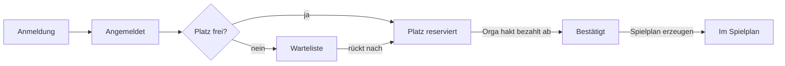

# Satzball – Konzept

> Turnierplanung für interne Volleyball-Turniere an der DHSN

**Stand:** 12.10.2026 · **Autor:** Maxim

## Ziel & Rahmen

Die App ersetzt Excel-Liste und WhatsApp-Chaos: Teams melden sich online an, die Orga sieht auf einen Blick, wer bezahlt hat, und alle sehen Spielplan und Ergebnisse auf dem Handy.

**Leitprinzip:** Eine Person soll die App in wenigen Wochen nebenher bauen und betreiben können. Jede Funktion muss sich gegen "geht auch mit einem Zettel" behaupten.

**Annahmen:**

- Nur interne Turniere an der DHSN, ca. 8–16 Teams, 1–3 Turniere pro Jahr.
- Startgebühr wird bar oder per Überweisung/PayPal an die Orga gezahlt. Die App zahlt nichts, sie **trackt** nur den Status.
- Es gibt eine kleine Orga (1–3 Personen) als Admins.
- Keine Nutzerkonten für Spieler. Teams bearbeiten ihre Daten über einen geheimen Link.
- Mobile-first: Die meisten schauen am Spieltag in der Halle aufs Handy.

## Rollen & Rechte

Drei Rollen reichen; nur die Orga braucht ein echtes Login.

| Rolle | Zugang | Darf |
| --- | --- | --- |
| Orga (Admin) | Login mit Benutzername + Passwort | Turniere anlegen, Anmeldung öffnen/schließen, Teams freigeben/ablehnen, Zahlungen abhaken, Spielplan erzeugen und anpassen, Ergebnisse eintragen |
| Teamkapitän | Geheimer Bearbeitungslink (per Mail nach Anmeldung) | Team anmelden, Spielerliste bis zum Meldeschluss ändern, eigenen Zahlungsstatus sehen |
| Öffentlich | Kein Login | Teamliste, Spielplan, Ergebnisse und Tabelle ansehen |

Der Bearbeitungslink enthält einen zufälligen Token (z. B. 32 Zeichen). Das spart Registrierung, Passwort-Reset und Kontoverwaltung komplett.

## Funktionsumfang

Das MVP deckt genau die vier Kernwünsche ab: Anmeldung, Spielerliste, Spielplan, Zahlungs-Tracking. Alles andere wartet, bis das erste Turnier damit gelaufen ist.

**MVP (erstes Turnier)**

- [ ] Orga legt Turnier an: Name, Datum, Ort, Startgebühr, Meldeschluss, max. Teams, Spieler pro Team (min./max.)
- [ ] Öffentliches Anmeldeformular: Teamname, Kapitän (Name, E-Mail), Spielerliste
- [ ] Kapitän erhält Bearbeitungslink und kann Spieler bis Meldeschluss ändern
- [ ] Orga-Übersicht aller Teams mit Status (angemeldet, bestätigt, Warteliste) und Haken "bezahlt" inkl. Datum und Zahlungsart
- [ ] Spielplan per Knopfdruck erzeugen, Modus wählbar (Jeder-gegen-jeden oder Gruppen + K.-o.), auf 2 Felder verteilt, danach manuell anpassbar
- [ ] Zählmodus pro Turnier wählbar: Satz-Modus (Best of 1/3/5) oder Punkte-Modus (ein Satz auf X Punkte); Ergebnisse eintragen, Tabelle berechnet sich automatisch
- [ ] Öffentliche Seite mit Spielplan, Ergebnissen, Tabelle (mobil lesbar)

**Später, nur bei Bedarf**

- K.-o.-Phase automatisch aus Gruppentabellen befüllen
- Mehrere Felder/Zeitslots automatisch zuweisen
- Export der Teamliste als CSV (Startgeld-Abrechnung)
- E-Mail-Erinnerung an Teams, die noch nicht bezahlt haben

**Bewusst nicht:** Online-Bezahlung, Nutzerkonten für Spieler, Live-Ticker, Chat, Native App.

## Datenmodell

Fünf Tabellen genügen. Die Zahlung hängt direkt am Team (ein Team zahlt einmal), deshalb keine eigene Zahlungstabelle.

| Tabelle | Wichtige Felder | Beziehung |
| --- | --- | --- |
| Turnier | id, name, datum, ort, startgebuehr_eur, meldeschluss, max_teams, min_spieler, max_spieler, anmeldung_offen, modus (jeder_gegen_jeden / gruppen_ko), anzahl_felder, zaehlmodus (saetze / punkte), gewinnsaetze (1 / 2 / 3 = Best of 1 / 3 / 5), punkte_pro_satz (z. B. 25), punkte_entscheidungssatz (z. B. 15) | hat viele Teams, Gruppen, Spiele |
| Team | id, turnier_id, name, kapitaen_name, kapitaen_email, edit_token, status (angemeldet / bestaetigt / warteliste / abgesagt), bezahlt (ja/nein), bezahlt_am, zahlungsart (bar / ueberweisung / paypal), notiz, gruppe_id | gehört zu Turnier; hat viele Spieler |
| Spieler | id, team_id, vorname, nachname, studiengang (optional) | gehört zu Team |
| Gruppe | id, turnier_id, name (A, B, …) | hat viele Teams und Spiele |
| Spiel | id, turnier_id, gruppe_id (leer bei K.-o.), runde, feld, uhrzeit, team_a_id, team_b_id, saetze_a, saetze_b, punkte_a, punkte_b, schiri_team_id (optional), status (geplant / beendet) | gehört zu Turnier |

Die Tabelle (Platzierung) wird **nicht gespeichert**, sondern bei jedem Aufruf aus den beendeten Spielen berechnet. So kann sie nie veralten.

## Turniermodus & Spielplan

Die Orga wählt pro Turnier den Modus: reines Jeder-gegen-jeden (alle Teams in einer Gruppe) oder Gruppenphase mit anschließender K.-o.-Runde der Gruppenbesten. Die App erzeugt einen Vorschlag, die Orga darf alles per Hand verschieben.

**Erzeugung in drei Schritten**

1. **Gruppen bilden:** Bestätigte Teams zufällig (oder per Hand) auf Gruppen verteilen, möglichst gleich groß (z. B. 4–5 Teams). Im Modus Jeder-gegen-jeden gibt es genau eine Gruppe mit allen Teams.
2. **Paarungen pro Gruppe:** Rundenturnier nach der *Kreismethode*. Bei ungerader Teamzahl kommt ein Platzhalter "spielfrei" dazu. Ein Team pfeift jeweils ein Spiel, in dem es nicht spielt.
3. **Zeitslots verteilen:** Spiele reihum auf Felder und Uhrzeiten legen (Startzeit + Runde × Slotlänge), sodass kein Team zweimal im selben Slot steht.

Anzahl Spiele in einer Gruppe mit n Teams:

```math
\text{Spiele} = \frac{n \cdot (n-1)}{2}
```

**Rechenbeispiel:** 10 Teams, 2 Gruppen à 5, 2 Felder, 20 Minuten pro Slot.

- Pro Gruppe: 5 × 4 / 2 = 10 Spiele, zusammen 20 Gruppenspiele.
- Bei 2 Feldern: 20 / 2 = 10 Slots → 10 × 20 min = 200 min, also gut 3 Stunden.
- Plus Halbfinale (2 Spiele = 1 Slot) und Finale + Spiel um Platz 3 (1 Slot): weitere 40 min.
- Gesamt rund 4 Stunden. Bei mehr Teams lieber Slotlänge (z. B. 1 Satz bis 25) kürzen als ein drittes Feld einzuplanen.

**Tabellenwertung** (in dieser Reihenfolge, für die Orga einstellbar):

1. Gewonnene Spiele
2. Satzdifferenz
3. Ballpunktdifferenz
4. Direkter Vergleich

**Zählmodus:** Die Orga legt ihn pro Turnier fest; Eingabe, Anzeige und Tabelle passen sich an.

| Modus | Spiel gewonnen, wenn … | Ergebnis-Eingabe | Tabellenwertung |
| --- | --- | --- | --- |
| Satz-Modus | ein Team die eingestellte Zahl an Sätzen gewinnt (Best of 3 = 2 Sätze) | Sätze je Team, optional Punkte je Satz | Siege, Satzdifferenz, Ballpunktdifferenz, direkter Vergleich |
| Punkte-Modus | ein Team zuerst die Zielpunktzahl erreicht (ein Satz, z. B. bis 25) | Punkte je Team | Siege, Punktdifferenz, erzielte Punkte, direkter Vergleich |

Im Punkte-Modus gibt es kein Unentschieden, weil auf eine feste Punktzahl gespielt wird. Die Slotlänge im Spielplan sollte zum Modus passen (Punkte-Modus kürzer).

## Seiten & Abläufe

Acht Seiten reichen; drei davon liefert der Django Admin fast geschenkt.

| Seite | Wer | Inhalt |
| --- | --- | --- |
| Startseite | alle | Aktuelles Turnier, Datum, Ort, Button "Team anmelden" |
| Anmeldeformular | alle | Teamname, Kapitän, Spielerliste (Zeilen hinzufügen), Datenschutz-Checkbox |
| Team bearbeiten | Kapitän (Link) | Spieler ändern bis Meldeschluss, Status + Zahlungsstatus sehen |
| Teamliste | alle | Nur Teamnamen und Status |
| Spielplan & Ergebnisse | alle | Spiele nach Uhrzeit und Feld, Ergebnisse, Tabellen je Gruppe |
| Orga: Teams | Orga | Liste mit Filtern (unbezahlt, Warteliste), Haken "bezahlt", Summe Startgebühren |
| Orga: Spielplan | Orga | Gruppen bilden, Plan erzeugen, Spiele verschieben |
| Orga: Ergebnisse | Orga | Sätze pro Spiel eintragen, schnell am Handy bedienbar |

**Team-Status von der Anmeldung bis zum Spielplan**



Wer keinen Platz bekommt, landet auf der Warteliste und rückt bei einer Absage nach. In den Spielplan kommen nur Teams, deren Startgebühr die Orga abgehakt hat.

## Tech-Stack & Hosting

Empfehlung: **Django + SQLite, serverseitig gerenderte Seiten.** Ein Repo, ein Prozess, eine Datei als Datenbank.

| Baustein | Wahl | Warum |
| --- | --- | --- |
| Backend | Python + Django | Models, Formulare, Validierung und Login sind eingebaut |
| Orga-Backend | Django Admin | Teamliste mit Filter "unbezahlt", Haken setzen, Spiele bearbeiten – fast ohne eigenen Code |
| Datenbank | SQLite | Reicht für ein paar hundert Datensätze locker; Backup = Datei kopieren |
| Frontend | Django-Templates + ein schlankes CSS (z. B. Pico.css) | Kein Build-Schritt, kein SPA-Framework; optional htmx für Ergebnis-Eingabe ohne Reload |
| E-Mail | SMTP (Hochschul- oder Orga-Postfach) | Nur für den Bearbeitungslink |
| Hosting | Privater kleiner Linux-Server (VPS) mit Docker | Ein Container, Gunicorn dahinter, HTTPS über Reverse Proxy |

**Alternative**, falls das Team lieber JavaScript schreibt: Next.js + SQLite (Prisma). Dann fehlt aber das fertige Admin-Backend, das hier am meisten Arbeit spart.

Keine Microservices, keine separate API, kein Kubernetes, kein Redis.

## Datenschutz

So wenig Daten wie möglich: Name der Spieler, eine E-Mail pro Team. Keine Telefonnummern, keine Matrikelnummern.

- Öffentlich sichtbar sind Teamnamen, Spielernamen und Ergebnisse; E-Mail und Zahlungsstatus sieht nur die Orga (und der eigene Kapitän).
- Kurzer Datenschutzhinweis + Checkbox im Anmeldeformular.
- Teams und Spieler eines Turniers nach einer festen Frist löschen (z. B. 3 Monate nach dem Turnier); Ergebnisse dürfen bleiben.

## Entscheidungen

| Frage | Entscheidung | Folge fürs Konzept |
| --- | --- | --- |
| Turniermodus | Beides möglich: Jeder-gegen-jeden oder Gruppen + K.-o. | Feld `modus` am Turnier, Generator kann beides |
| Sonderregeln | Keine Mixed-Regeln, normale Hallenvolleyball-Regeln | Anmeldung prüft nur min./max. Spieler |
| Felder | 2 Felder | Slot-Verteilung auf 2 Felder ausgelegt |
| Hosting | Privat | Eigener kleiner Server (VPS) mit Docker; Betreiber ist für Backups und Datenschutz verantwortlich |
| Satzpunkte | Nicht einzeln speichern | Spiel hat nur `saetze_a/b` und `punkte_a/b` (Ballpunkt-Summe) |
| K.-o.-Spiele vorab | Teams optional, Platzhalter-Text | Felder `platzhalter_a/b` am Spiel, z. B. "1. Gruppe B" |
| Spielernamen | Öffentlich in der Teamliste | Hinweis im Anmeldeformular |
| Bestätigung | Bezahlt = bestätigt | Haken "bezahlt" setzt Status automatisch auf bestätigt |
| Besondere Runden | Erkennbar | Feld `phase` am Spiel (Viertelfinale, Halbfinale, Spiel um Platz 3, Finale) |
| Team löschen | Auch mit geplanten Spielen | Spielplan wird danach automatisch neu erzeugt (Schritt 4) |
| Warteliste | Orga entscheidet per Klick | Kein automatisches Nachrücken bei Absage; Admin-Aktion "Nachrücken" |

**Noch offen:**

- [ ] Braucht es bei privatem Hosting ein Impressum und eine eigene Datenschutzerklärung – und wer prüft das?

## Umsetzungsplan

1. **Grundgerüst:** Django-Projekt, Models, Admin, Deployment eines leeren Projekts (früh deployen!).
2. **Anmeldung:** öffentliches Formular mit Spielerliste, Bearbeitungslink per Mail, Meldeschluss.
3. **Zahlungs-Tracking:** Felder im Admin, Filter "unbezahlt", Summe eingegangener Startgebühren.
4. **Spielplan:** Gruppen bilden, Kreismethode, Slots verteilen, Ergebnis-Eingabe, Tabellenberechnung (mit Unit-Tests).
5. **Öffentliche Seiten:** Spielplan, Ergebnisse, Tabelle, mobil getestet.
6. **Probelauf** mit Testdaten, dann echtes Turnier. Erst danach Punkte aus "Später" angehen.
